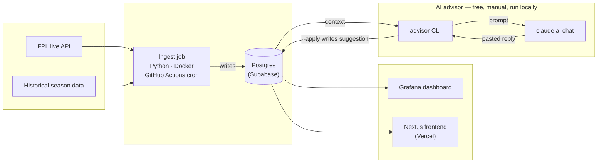

# Fantasy Premier League Pipeline

[](LICENSE)


A data pipeline for Fantasy Premier League: ingest live FPL API data and historical
season data into Postgres, then consume it through a live web frontend, a Grafana
dashboard, and an LLM-based transfer/captaincy advisor.

## Contents

- [Features](#features)
- [Architecture](#architecture)
- [Local development](#local-development)
- [Production setup (Supabase + GitHub Actions)](#production-setup-supabase--github-actions)
- [Frontend (Next.js on Vercel)](#frontend-nextjs-on-vercel)
- [AI advisor](#ai-advisor)

## Features

- **Overview** — a redesigned home for season metrics, interactive charts, squad previews,
  gameweek snapshots, advisor insights, leagues, and upcoming fixtures.
- **Squad** — live formation view of your current squad: captain/vice-captain,
  injury/suspension flags, next-fixture difficulty, points per player.
- **Dashboard** — season points history, overall rank, and top scorers.
- **Transfers** — an AI-generated shortlist of transfer ideas each gameweek:
  up to 3 ranked free-transfer options (best one highlighted) plus a
  separate call on whether any transfer is worth a -4 point hit, and a
  captain/vice-captain pick.
- **Leagues & Cups** — every classic and head-to-head league you're in, with
  your rank and its change since last gameweek; classic leagues also get a
  full standings table with your row highlighted.
- **Grafana dashboard** — an alternate view of the same warehouse for local/self-hosted use.

## Architecture



The ingest job writes every live/historical fact to Postgres on its own
schedule. The advisor never calls a paid API — it only writes back when you
manually run `--apply` after pasting its prompt into a free claude.ai chat
(see [AI advisor](#ai-advisor) below). Everything else — the dashboard, the
frontend, the advisor's own context — only ever reads, so the advisor can
reason over real multi-season history instead of just the current gameweek
snapshot.

## Local development

Requires Docker and Python 3.11+.

```
cp .env.example .env
docker compose up -d
pip install -e ".[dev]"
```

`DATABASE_URL` in `.env` points at the local Docker Postgres by default. The
production ingest job (run via GitHub Actions) points at a hosted Supabase
Postgres instance instead, configured via repo secrets.

`docker compose up -d` also starts Grafana at http://localhost:3001
(login `admin` / `admin`, or whatever `GRAFANA_ADMIN_PASSWORD` is set to) with
an "FPL Overview" dashboard already provisioned — current rank, season points,
top scorers, and your current squad. It reads from the same local Postgres by
default; to point it at production Supabase instead, override the
`GRAFANA_POSTGRES_*` variables in `.env` with the session pooler
host/port/db/user/password and set `GRAFANA_POSTGRES_SSLMODE=require`.

## Production setup (Supabase + GitHub Actions)

The GitHub Actions workflow (`.github/workflows/ingest.yml`) needs two repo
secrets, set at Settings → Secrets and variables → Actions:

- `DATABASE_URL` — Supabase's **session pooler** connection string (Project
  Settings → Database → Connection string → Session pooler tab), of the form
  `postgresql://postgres.<ref>:<password>@aws-0-<region>.pooler.supabase.com:5432/postgres`.
  Use the pooler host, not the direct `db.<ref>.supabase.co` host — the direct
  host is IPv6-only and fails to resolve on many networks/runners.
- `FPL_TEAM_ID` — your FPL entry id.

The schema and historical backfill only need to be run once against a fresh
Supabase database (the scheduled job only handles the live/current-season
data from then on):

```
export DATABASE_URL="<supabase session pooler connection string>"
python -m fpl_pipeline.db.connection
python -m fpl_pipeline.ingest.historical
```

## Frontend (Next.js on Vercel)

A real web app (`web/`) that queries Supabase directly from the browser/server
(no Python backend involved) — a squad page with a live formation view, a
dashboard (rank/points history, top scorers), a transfer-suggestions page,
and a Leagues & Cups page listing every classic/head-to-head league you're
in, with a standings table (your row highlighted) for each classic league.
Head-to-head leagues are listed but don't get a standings table yet — their
scoring model (match points, not total points) needs a different view.

This only works because Row Level Security is enabled on every table with a
public **read-only** policy for the `anon` role (see `schema.sql`) — the
frontend uses Supabase's anon/publishable key, which is meant to be public
and safe to embed in client code; it can only ever `SELECT`, never write.

### Local development

```
cd web
cp .env.local.example .env.local
```

Fill in `.env.local` with your Supabase project URL and anon/publishable key
(Project Settings → API):

```
npm install
npm run dev
```

Visit http://localhost:3000 (overview), `/squad`, `/dashboard`, `/transfers` (AI transfer
suggestions — see below), and `/leagues` (your classic/H2H league standings).

### Deploy to Vercel

1. Go to vercel.com → **New Project** → import this GitHub repo.
2. Set **Root Directory** to `web` (important — the Next.js app isn't at the repo root).
3. Add two environment variables (from the same Supabase API settings page):
   - `NEXT_PUBLIC_SUPABASE_URL`
   - `NEXT_PUBLIC_SUPABASE_ANON_KEY`
4. Deploy. Every push to `main` auto-deploys; every page load fetches fresh
   data straight from Supabase, so there's nothing to keep "in sync" — no
   ingest job dependency, no rebuild needed when the data changes.

## AI advisor

The advisor keeps the manual copy-paste workflow. It makes no LLM API calls,
requires no API key, and has no website generation button. Run ingestion first
so player prices, availability and fixtures are recent.

```sh
python -m fpl_pipeline.advisor > prompt.txt
```

Without a confirmed current snapshot this produces **research only** using the
last locked squad. Public historical picks cannot reveal transfers made since
that deadline, today's bank, or real selling prices. The advisor leaves those
values unknown rather than claiming they are current.

For precise transfer checks, prepare a local `current-state.json` using your
current My Team/Transfers information. It must contain the season, entry ID,
upcoming gameweek, a timezone-aware `captured_at` timestamp within 24 hours,
all 15 picks (FPL player IDs, lineup positions 1-15, actual selling prices),
and `transfers.bank`, `transfers.limit`, `transfers.made`. Money is in tenths
of a million: 52 means GBP 5.2m. `limit` is the allocation **before** this week's
moves, not the number remaining; e.g. limit 2 and made 2 leaves zero free
transfers. See [the snapshot format and audit](docs/advisor-audit.md).

```sh
python -m fpl_pipeline.advisor --state current-state.json > prompt.txt
```

Paste `prompt.txt` into your preferred chat and save the reply as `reply.txt`.
Validate it against the same current snapshot before saving:

```sh
python -m fpl_pipeline.advisor --state current-state.json --apply reply.txt --check
python -m fpl_pipeline.advisor --state current-state.json --apply reply.txt
```

`--check` never writes. `--apply` validates the reply's context fingerprint,
remaining transfers, position, ownership, club limit, real selling value,
bank and captain eligibility before writing `advisor_suggestions`. It saves
advice only; it never executes FPL transfers. If your squad, prices or fixtures
change, generate a fresh prompt. A stale response is rejected.

The suggestions are up to three independent single-transfer alternatives,
not a combined transfer plan. Scores rank recent form and fixtures; they are
not expected points. Points-hit suggestions are disabled until a calibrated
forecast can substantiate them. Chip recommendations require confirmed
availability and remain planning signals for you to review.

The website displays saved advice and warns about legacy or expired snapshots.
It cannot detect moves you make after the supplied snapshot. Current-state
files, prompts and replies are ignored by Git; no extra service key is needed.
