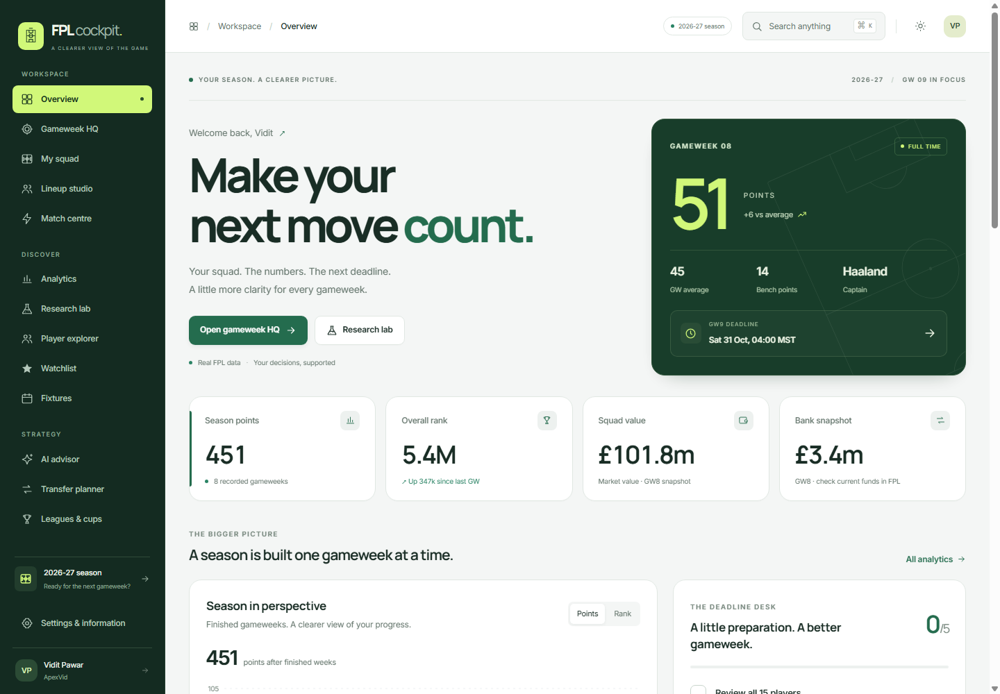
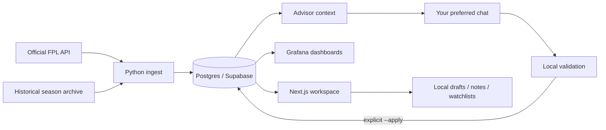

# FPL Cockpit

### Less guesswork. A clearer game plan.

A personal Fantasy Premier League command centre for the whole season: understand your results, research your next pick, rehearse your starting XI and arrive at the deadline with a plan.

Built with **Next.js, React, TypeScript and Python**, backed by your own **Postgres / Supabase** warehouse. Real FPL data, explicit freshness, and transfer advice that checks the squad before making a suggestion.

[](LICENSE)




[Explore the workspace](#the-workspace) · [Get started](#get-started) · [Run the advisor](#the-transfer-advisor) · [Deploy](#deployment) · [Documentation](#documentation)

## What you can do

| Area | What it gives you |
| --- | --- |
| **Season command centre** | A gameweek scorecard, season metrics, interactive progress charts, all 15 squad members, fixture previews, player research and league snapshots. |
| **Gameweek HQ** | A live deadline countdown, calendar reminder export, preparation checklist, availability checks and a private device-local notebook. |
| **Lineup studio** | A tactical board with legal starter/bench swaps, captain and vice selection, ordered substitutes, saved drafts, JSON export and printable team sheets. |
| **Autosub rehearsal** | Test zero-minute absences, one-minute cameos, goalkeeper replacements, multiple absences and captain fallback. Explore Bench Boost and Triple Captain scenarios. |
| **Research lab** | Budget and ownership presets, player screening, captain shortlists, fixture difficulty windows, a fixture-swing finder, saved research views and filtered CSV export. |
| **Player explorer** | Search the player pool, inspect game logs, compare up to four players and keep a season-specific watchlist. |
| **Transfer planner** | Model up to five gameweeks with real selling values, simultaneous transfer bundles, club limits, free-transfer rollover and hit costs. |
| **Squad & fixtures** | Pitch/list views, player panels, formation-aware squad coverage, calendar-week fixture grids, blanks and doubles. |
| **Performance analytics** | Compare points with the gameweek average, follow rank and squad value, inspect bench points and transfer costs, and export a gameweek journal. |
| **Leagues & match centre** | Classic/H2H league summaries, classic standings, nearby rivals and saved match scores with FPL scoring multipliers. |
| **Validated advisor** | A manual prompt/reply workflow with current-squad validation, independent transfer alternatives, post-transfer XIs, bench-cover checks and stale-advice notices. |
| **Workspace backups** | Export device-local plans, notes, watchlists and research views, then preview and restore them in another browser. Matching entries are replaced; unrelated storage is untouched. |

The interface includes light and dark appearances, responsive desktop/mobile navigation, keyboard search, loading states, retry views and reduced-motion support.

## The workspace

| Route | Use it for |
| --- | --- |
| `/` | Your season command centre |
| `/gameweek` | Deadline preparation, checklist, notes and calendar export |
| `/lineup` | Lineup drafts, bench order, armbands and autosub rehearsal |
| `/lab` | Player screening, captain shortlists and fixture swings |
| `/squad` | All 15 saved players, formation and future squad coverage |
| `/live` | The latest saved gameweek scoring snapshot |
| `/players` | Player search and detailed filtering |
| `/players/[code]` | A player profile, history and upcoming fixtures |
| `/players/compare?codes=…` | Side-by-side comparison of two to four players |
| `/watchlist` | Your device-local season shortlist |
| `/planner` | Multiweek transfer scenarios and confirmed-squad export |
| `/fixtures` | The fixture difficulty ticker |
| `/transfers` | Saved transfer, captaincy, lineup and chip advice |
| `/dashboard` | Detailed season analytics and CSV export |
| `/leagues` | Your classic and head-to-head leagues |
| `/leagues/[id]` | Classic league standings and rival gaps |
| `/settings` | Appearance, connection status, data freshness and shortcuts |

**Keyboard:** `Ctrl + K` / `⌘ + K` searches pages and players. `Esc` closes search and player panels. Inputs, filters and lineup controls work without dragging.

## How the data flows



- **Python writes the warehouse.** The scheduled ingest runs every two hours; completed historical seasons can be backfilled separately.
- **The web app reads Supabase.** It uses the public read-only key and needs no Python HTTP server or database password in the browser.
- **The advisor is manual.** It creates a prompt for your preferred chat, validates the returned JSON and saves advice only when you run `--apply`. No paid LLM API is required.
- **Drafts stay on your device.** Watchlists, comparisons, lineup drafts, research views, preparation checks and notes use local storage. They do not sync between devices.

## Get started

### Requirements

- Python **3.11+**.
- Node.js **22+** and npm.
- A Supabase project for the web app's data connection.
- Your FPL entry ID, found in the URL of your FPL team profile.
- Docker is optional for local Postgres and Grafana.

### 1. Set up the pipeline

From the repository root, using PowerShell:

```powershell
python -m venv .venv
.\.venv\Scripts\Activate.ps1
pip install -e ".[dev]"
Copy-Item .env.example .env
```

If `.env` already exists, keep it and update the relevant values. Configure:

```dotenv
DATABASE_URL=postgresql://postgres.<project-ref>:<password>@<session-pooler-host>:5432/postgres
FPL_TEAM_ID=<your-entry-id>
```

Use your Supabase **session pooler** connection details. The application also accepts `SUPABASE_DATABASE_URL`, but **`DATABASE_URL` takes precedence** when both are set. A leftover localhost URL will still select the local database.

Apply the schema and load the current season:

```powershell
python -m fpl_pipeline.db.connection
python -m fpl_pipeline.ingest.live
```

Optionally backfill the five most recently completed seasons:

```powershell
python -m fpl_pipeline.ingest.historical
```

Historical double-gameweek rows are aggregated into a single player/gameweek total. If updating an older warehouse, rerun the backfill to repair totals previously overwritten by per-fixture upserts.

### 2. Start the web app

```powershell
cd web
npm ci
Copy-Item .env.local.example .env.local
```

Set these values in **`web/.env.local`**:

```dotenv
NEXT_PUBLIC_SUPABASE_URL=https://<project-ref>.supabase.co
NEXT_PUBLIC_SUPABASE_ANON_KEY=<public-anon-or-publishable-key>
```

Then:

```powershell
npm run dev
```

Open **http://localhost:3000**. Start with Gameweek HQ, or explore your squad in the lineup studio.

> The root `.env` configures Python. `web/.env.local` configures Next.js. They are separate. Never place a database password or Supabase service-role key in a `NEXT_PUBLIC_*` variable.

On macOS/Linux, activate the environment with `source .venv/bin/activate` and use `cp` for the example-file copies. The Python and npm commands are the same.

### Optional: local Postgres & Grafana

```powershell
docker compose up -d
```

This starts Postgres on **5432** and Grafana at **http://localhost:3001**. The Compose configuration uses `fpl` as the local database/user and reads Grafana settings from `.env`. Replace development passwords for any externally exposed installation.

Local Postgres alone does not provide the Supabase REST endpoint used by the web app. Use a hosted Supabase project or a compatible local Supabase setup for the frontend. Grafana can use local Postgres directly; the `GRAFANA_POSTGRES_*` settings can also point it at your hosted session pooler.

## The transfer advisor

The advisor compares a move with **keeping and optimizing the existing 15-player squad**, rather than simply buying a recent high scorer.

It checks position, ownership, club limits, current bank, actual selling values, remaining free transfers, legal formations, captain eligibility and usable bench cover. Each alternative includes its own post-transfer XI and ordered bench.

### Generate, review, validate, save

1. Refresh the warehouse.
2. Confirm your current squad, bank, selling prices and transfer allowance. The transfer planner can export an advisor-compatible `current-state.json` once its baseline is confirmed and all selling values are supplied.
3. Generate the prompt:

```powershell
python -m fpl_pipeline.advisor --state current-state.json > prompt.txt
```

4. Paste the prompt into your preferred chat and save the response as `reply.txt`.
5. Validate it, then save it:

```powershell
python -m fpl_pipeline.advisor --state current-state.json --apply reply.txt --check
python -m fpl_pipeline.advisor --state current-state.json --apply reply.txt
```

`--check` is read-only. `--apply` saves advice to the warehouse; it never executes a transfer in your FPL account.

Without `--state`, the prompt is **research only**. Public locked picks cannot establish transfers since the deadline, today's bank or your real selling prices.

### Important boundaries

- The current-state confirmation must be within **24 hours**, and warehouse data must be within **six hours** before advice can be saved.
- Transfer `limit` means the allocation **before** this week's moves. `limit: 2` and `made: 2` leaves zero free transfers.
- Money in state files is in tenths of a million: `52` means **£5.2m**.
- Suggested moves are independent alternatives. Three ideas do not mean three transfers should be made.
- Ranking indices are **not expected points**. Paid-hit recommendations remain disabled.
- The experimental underlying-data ranking stays inactive until it clears a historical evaluation gate. A ranking diagnostic is not proof of future transfer profitability.
- Team news, future minutes, price changes and outcomes remain uncertain. Check the snapshot date and official FPL before acting.

Run the read-only walk-forward ranking comparison:

```powershell
python -m fpl_pipeline.advisor --evaluate
```

The [advisor audit](docs/advisor-audit.md) documents the state format. The [GW8 investigation](docs/gameweek-8-review.md) explains the model checks, measured limitations and bench-review fixes.

## What “live” means here

The match centre reloads the latest **warehouse snapshot** every minute. Ingestion normally runs every **two hours**, so points, prices and team news can lag the official game. The interface displays the last successful ingest timestamp; loading a page does not make the source data newer.

Gameweek analytics use confirmed finished weeks by default. Unfinished weeks are marked provisional. Saved FPL multipliers include autosubs, captain fallback and chips when those values have been published and ingested.

Research uses observed statistics and fixture difficulty. Lineup rehearsals use the hypothetical minutes you set. Chip scenarios do not confirm that a chip is available in your account.

The website does not execute FPL transfers, publish your lineup, log in to your FPL account, or generate new AI advice when refreshed. Optional pipeline authentication is separate and may fail if FPL changes its login flow; a manually confirmed state file remains the supported advisor workflow.

## Deployment

### Supabase

Apply `src/fpl_pipeline/db/schema.sql` using the schema command. The schema enables public read-only policies for the Supabase `anon` role. Browser clients can read the exposed warehouse data; writes remain with the pipeline/database owner. This is a personal single-manager workspace, not a private multi-tenant account system.

### GitHub Actions

Add repository secrets:

| Secret | Purpose |
| --- | --- |
| `DATABASE_URL` | Hosted Postgres session-pooler connection string |
| `FPL_TEAM_ID` | Entry to ingest |

[Live ingest](.github/workflows/ingest.yml) runs every two hours and can be dispatched manually. Its Docker command applies the schema before ingestion. Historical backfills are run separately. [Quality checks](.github/workflows/checks.yml) run the regression suites and production web build; schema permissions are exercised in an isolated test database.

### Vercel

1. Import this repository into Vercel.
2. Set **Root Directory** to `web`.
3. Add `NEXT_PUBLIC_SUPABASE_URL` and `NEXT_PUBLIC_SUPABASE_ANON_KEY`.
4. Deploy through your normal repository workflow.

The app reads current warehouse data per request. Code changes require a deployment; new ingested scores or saved advisor rows do not require a rebuild. Local changes are not published automatically by this workspace.

## Development & validation

From the repository root:

```powershell
python -m pytest -q
python -m ruff check src tests
```

From `web/`:

```powershell
npm test
npm run lint
npx tsc --noEmit
npm run build
npm run start
```

The JavaScript suite uses Node's built-in test runner and the installed TypeScript compiler. Coverage includes analytics denominators, planner affordability and rollover, squad/bench constraints, autosub priority, cameo handling, captain fallback, fixture windows, local-state parsing, calendar output and CSV escaping.

Schema integration tests require `FPL_TEST_DATABASE_URL` to point at a dedicated database whose name ends in `_test`. They are skipped locally when that database is absent and run against an isolated Postgres service in CI.

## Project map

```text
src/fpl_pipeline/
  api/                  FPL client
  ingest/               Current-season ingestion and historical backfills
  db/                   Connections, schema and read-only views
  advisor/              Context, ranking, decisions, evaluation and CLI
web/
  app/                  App Router pages, shared shell and design tokens
  components/           Interactive workspace and visual components
  lib/                  Queries, analytics, planning and studio logic
  lib/*.test.mjs        Frontend regression tests
tests/                  Python unit and schema-integration tests
grafana/                Dashboard and datasource provisioning
.github/workflows/      Scheduled ingestion and quality checks
docs/                   Workflow guides and advisor audits
```

## Troubleshooting

| Symptom | Check |
| --- | --- |
| Python cannot connect | Confirm the effective DSN. `DATABASE_URL` overrides `SUPABASE_DATABASE_URL`. Check whether local Docker is running or select the hosted session pooler. |
| The web app shows a connection error | Check `web/.env.local`, the project URL, public key, schema and read policies. Restart the dev server after changing environment variables. |
| New scores are missing | Inspect the last successful ingest time and the Actions run. Page refreshes do not call FPL directly. |
| An advisor reply is rejected | Refresh ingestion, reconfirm state, regenerate the prompt and use the reply's matching context fingerprint. Do not reuse an old response after changing the squad. |
| A draft or watchlist is missing | Local storage is scoped to this browser, origin and season. Use exports for backups; device-local data does not sync. |
| A player missed one match | Check subsequent team news. A single absence does not establish injury or a permanent loss of place. |

## Documentation

- [Frontend guide](web/README.md)
- [Planning, watchlists and snapshot exports](docs/planning.md)
- [Advisor constraints and state format](docs/advisor-audit.md)
- [GW8 review and model limitations](docs/gameweek-8-review.md)
- [Official Fantasy Premier League help](https://fantasy.premierleague.com/help/faqs)

Historical data comes from the community-maintained [vaastav/Fantasy-Premier-League archive](https://github.com/vaastav/Fantasy-Premier-League). Current-season data comes from the official FPL API. Source availability, schedules and scoring corrections can change.

## License

[MIT](LICENSE). FPL Cockpit is an independent companion and is not affiliated with the Premier League or Fantasy Premier League. Club names and related marks belong to their respective owners.
